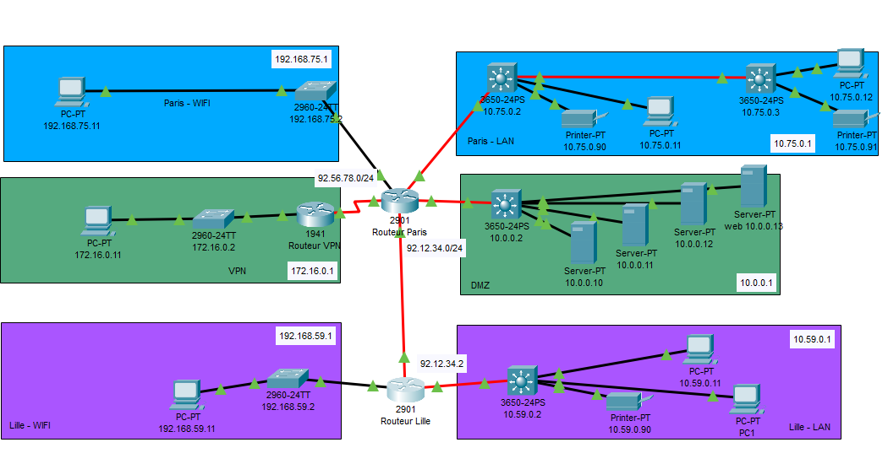

# 🌐 S03 : Atelier Packet Tracer

Premier atelier de la S03 du cursus Administrateur d'Infrastructures Sécurisées ! 

---

## 🍔 Au menu
- Adressage IPv4 & Plan de sous-réseaux
- Configuration de switchs Cisco
- Configuration de routeurs Cisco
- Routage statique
- Service DHCP centralisé (avec relais `ip helper-address`)

---

## 🏢 Contexte du projet
Une nouvelle entreprise vous recrute pour professionnaliser son réseau. Actuellement, les salariés sont connectés en WiFi sur des box FAI avec du matériel hétérogène, mais le parc informatique va être complètement renouvelé.

- **Effectif actuel :** 59 collaborateurs (extensible à plus de 200).
- **Répartition par service :**
  - Commerciaux : 16
  - Communication : 5
  - Comptabilité : 5
  - Direction : 4
  - Ressources Humaines : 2
  - Juridique : 2
  - Recherche & Développement (R&D) : 23
  - Informatique : 2
- **Implantations :** Bureaux à Paris (siège, salle serveur, R&D) et à Lille, plus un accès VPN distant.

---

## 🗺️ Topologie Réseau
Voici l'infrastructure déployée sur Cisco Packet Tracer :



---

## 🛠️ Étapes de réalisation

### Étape 1 : Plan d'adressage (basé sur la topologie)
Voici les sous-réseaux mis en place avec leurs notations CIDR et passerelles respectives :

- **Paris - LAN :** `10.75.0.0/24` (Passerelle routeur : `10.75.0.1`)
- **Paris - DMZ (Serveurs) :** `10.0.0.0/24` (Passerelle routeur : `10.0.0.1`)
- **Paris - WiFi Public :** `192.168.75.0/24` (Passerelle routeur : `192.168.75.1`)
- **Lille - LAN :** `10.59.0.0/24` (Passerelle routeur : `10.59.0.1`)
- **Lille - WiFi Public :** `192.168.59.0/24` (Passerelle routeur : `192.168.59.1`)
- **VPN :** `172.16.0.0/24` (Passerelle routeur VPN : `172.16.0.1`)
- **Liens inter-routeurs (WAN) :**
  - Paris ⟷ Lille : `92.12.34.0/24`
  - Paris ⟷ VPN : `92.56.78.0/24`

### Étape 2 : Câblage
Mise en place des liaisons en fibre optique entre les switchs et les routeurs, et de la liaison Serial DTE pour le routeur VPN.

### Étape 3 & 4 : Configuration des Switchs et Routeurs
Exemple de configuration de base appliquée sur les équipements Cisco :

```Routeur 2901
enable
configure terminal
hostname Routeur-Paris
enable secret *****
!
interface GigabitEthernet0/0 (Paris Wifi)
 ip address 192.168.75.1 255.255.255.0
 no shutdown
exit
interface Serial/0/0/0 (VPN)
 ip address 92.56.78.1 255.255.255.0
 no shutdown
exit
interface GigabitEthernet0/1/0 (Paris LAN)
 ip address 10.75.0.1 255.255.255.0
 no shutdown
exit
interface GigabitEthernet0/2/0 (Vers routeur Lille)
 ip address 92.12.34.1 255.255.255.0
 no shutdown
exit
interface GigabitEthernet0/3/0 (Vers DMZ salle Serveurs)
 ip address 10.0.0.1 255.255.255.0
 no shutdown
exit
